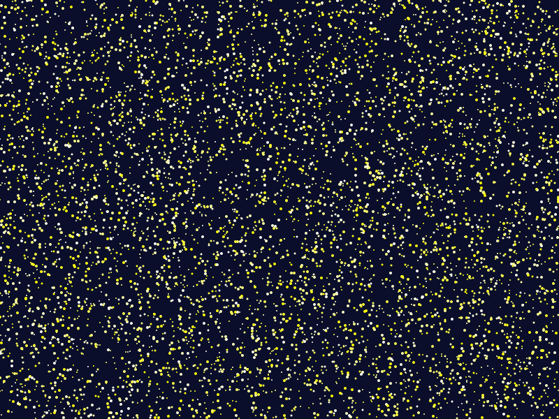

# Star Vault

**Put any file in, get a picture of a night sky out. Put the sky picture back in, get your exact file byte identical back.**

**TRY IT!** - https://stellar5055.github.io/star-vault

**How It Works** - Every byte of the uploaded file becomes one star. The star's color is the byte. To decode, we simply just read the colors back in order. The file is just that with a tiny header ('Star' + filename + length) at the front. No signup, no server, everything runs locally in the browser

**Capacity** - 1 byte = 1 star, so a 1 KB file makes roughly an 80 KB SVG.

**Biggest File I Tried** - Biggest so far: a 1.2 MB photo became 1,247,370 stars (~69 MB SVG) and came back identical (b8fd4e7d...9bd9a8bbdfb).

## Proof:

Real files, same hash before and after:

channels4_profile.jpg (6,678 B):  cf0ba5ae...2af65  ->  identical
07.png (87,852 B):                9f231b52...7a76d  ->  identical

## Files

- `index.html` — the app
- `example.sky.svg` — a sky with a file already inside, decode it

No build step, just open index.html — or use the demo link above.

_Try It..._
